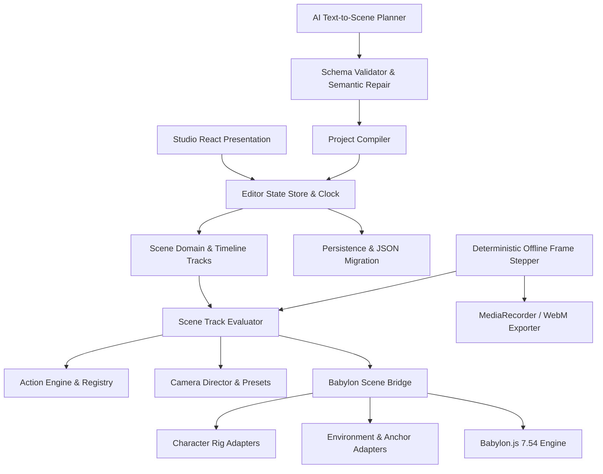

# Architecture Guide — Cinematic Animation Studio

## 1. Architectural Philosophy & Principles
The Cinematic Animation Studio is built on three core pillars:
1. **Decoupled Scene Domain from Rendering Engine**: Persistent project data is pure, portable, validated JSON Schema (Draft 2020-12). Runtime Babylon.js objects (`Scene`, `TransformNode`, `Mesh`, `Camera`, `Material`) are never stored inside project files.
2. **Single Deterministic Frame Clock**: Scenography, articulated kinematics, camera motion, dialogue, and effects are evaluated as a pure function of frame $F$ and $fps$:
   $$\text{SceneState}(F) = \text{Evaluator}(\text{Project}, F)$$
   This ensures identical reproduction whether scrubbing in real-time or rendering offline at 4K.
3. **Extensibility & Modularity**: Reusable catalogs for assets, rig profiles, interaction anchors, procedural actions, and camera presets allow new characters, environments, and stunts to be added without altering engine cores.

---

## 2. Target Module Boundaries

### Module Responsibilities
- **`src/schema/`**: Formal JSON Schema (Draft 2020-12), TypeScript definitions, and runtime Zod validation contracts.
- **`src/domain/`**: Pure data manipulation, default project factories, and ID generation.
- **`src/assets/`**: Catalog of 3D assets, rig profiles (`ANATOMICAL_PIVOT_RIG`), and semantic interaction anchors (`clearing_center`, `waterfall_shower_spot`, `tree_climb_start`, `moss_rock_bench`).
- **`src/runtime/`**: Lifecycle managers for Babylon engine, scene, lighting, dynamic shadows, articulated anatomical character pivots, and environmental anchors.
- **`src/actions/`**: Typed action definitions (`idle`, `walk_to`, `run_to`, `wave`, `sit_on`, `climb`, `take_shower`, `fly`, `jump`) and deterministic pose evaluation.
- **`src/camera/`**: 13 cinematic camera presets and dynamic camera director.
- **`src/timeline/`**: Deterministic clock and multi-track sequencer evaluator.
- **`src/ai/`**: Provider-agnostic text LLM planner, prompt builder, validation/repair engine, and compiler.
- **`src/render/`**: Deterministic offline frame stepper and video exporter.
- **`src/studio/`**: Complete React 19 visual workstation (topbar, scene hierarchy, inspector, viewport, sequencer, drawers).

---

## 3. Hardware Optimization & Quality Tiers
To ensure smooth performance on machines without a dedicated GPU:
- **`draft`**: 1.33x hardware scaling, disabled shadows and fog, simplified shaders.
- **`preview`**: 1.0x native scaling, key occluder soft shadows (mapSize 1024), mist fog.
- **`cinematic`**: DPR-adapted high-resolution rendering, blurred exponential shadow mapping (2048), full dynamic lighting and particle effects.
- **Offline Rendering**: Frame-by-frame stepper completely divorces rendering time from playback framerate.
